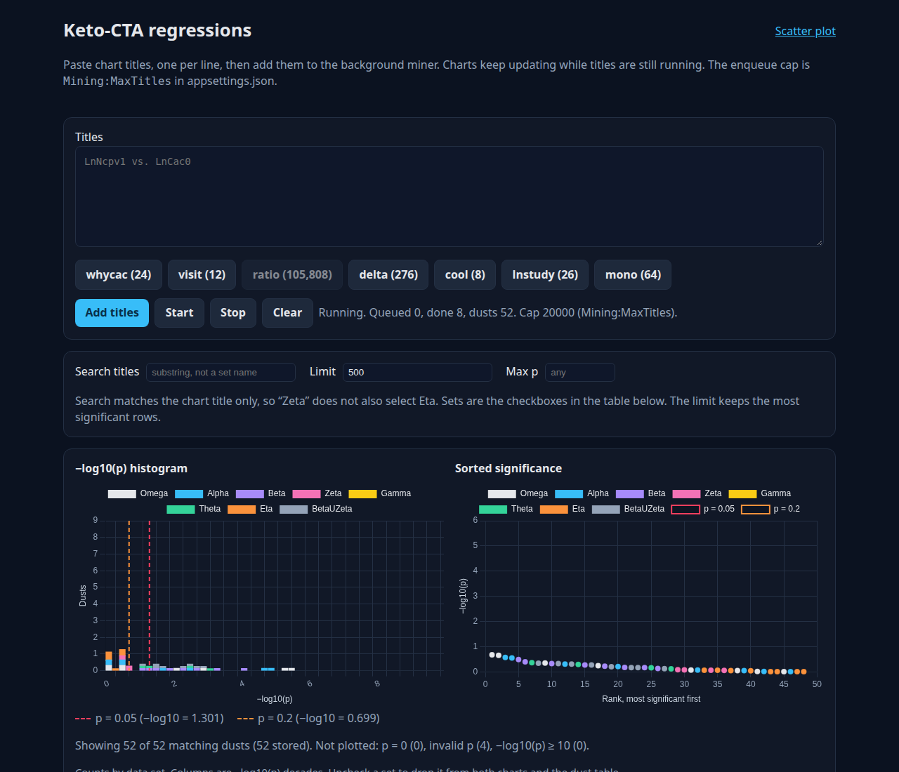
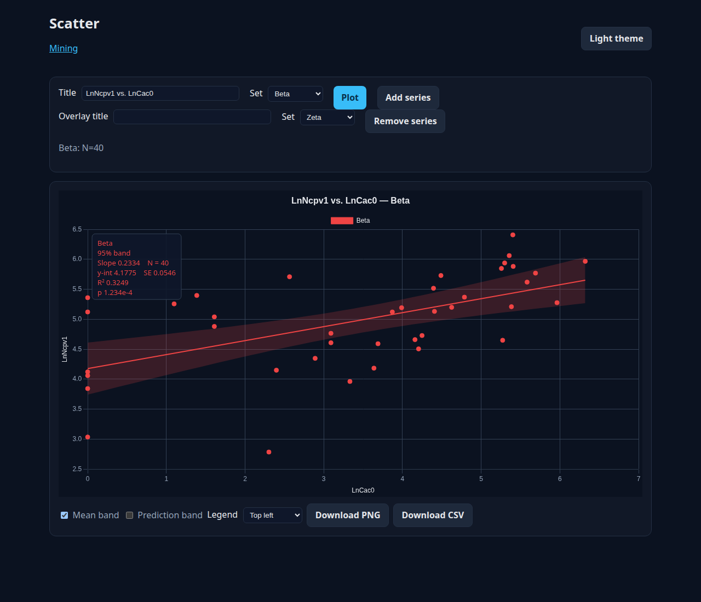

# Keto-CTA GoldMine web UI

Local pages for the [Keto-CTA](https://github.com/NinerXrayBravoTwoTwo/Keto_Cta) regressions. The study data is the public Citizen Science Foundation keto-CTA table (100 participants, two visits). This app is not a hosted site. It runs on your machine and reads the CSVs that ship in the clone.

What you can do:

- Mine chart titles in the background and filter the dusts while they are still running.
- Load a console matrix from a preset button.
- See a −log10(p) histogram split by data set, and a sorted significance curve.
- Open one regression as a scatter plot with the linear-regression line, a 95% mean band, an optional prediction band, and a legend corner you can move.



## Prerequisites

Install the [.NET 8 SDK](https://dotnet.microsoft.com/download/dotnet/8.0). The same SDK is used on Windows, macOS, Linux, and WSL. Check it with:

```bash
dotnet --version
```

You need an 8.x SDK (`8.0.428` is enough). No separate database, Node install, or Python install is required to run the pages. Chart.js is loaded from a CDN, so the browser needs network access the first time a chart draws.

## Clone and data files

```bash
git clone https://github.com/NinerXrayBravoTwoTwo/Keto_Cta.git
cd Keto_Cta
```

The two CSVs are already in the repo:

- `KetoCtaRegressions/TestData/keto-cta-quant-and-semi-quant.csv` — the quant and semi-quant table, one row per participant.
- `KetoCtaRegressions/TestData/keto-cta-qangio.csv` — 10 preliminary QAngio rows.

On startup the app looks for each file in this order (`FindData` in `Program.cs`):

1. `Data/` next to the running assembly (the build output copies the CSVs there).
2. `KetoCtaRegressions/TestData/` next to the `Keto-CTA-GoldMine` project, which is what `dotnet run` uses from a source checkout.

You do not download or place the files yourself for a normal clone.

## Run

From the repository root, in bash or WSL:

```bash
cd Keto-CTA-GoldMine
dotnet run --no-launch-profile --urls http://127.0.0.1:5176
```

The same `dotnet` invocation works in PowerShell. Only the directory change differs:

```powershell
Set-Location Keto-CTA-GoldMine
dotnet run --no-launch-profile --urls http://127.0.0.1:5176
```

`--no-launch-profile` ignores `Properties/launchSettings.json`, so the process uses the URL you passed and does not also open a browser or an HTTPS port. Leave the terminal running. Open the page yourself.

Stop it with Ctrl+C in that terminal.

## URLs

- http://127.0.0.1:5176/ — mining page.
- http://127.0.0.1:5176/scatter.html — scatter page.
- A scatter link can carry the chart:

  `http://127.0.0.1:5176/scatter.html?title=LnNcpv1%20vs.%20LnCac0&set=Beta&level=0.95&legend=tl`

  `title` is the chart title. `set` is one set name. `title2` and `set2` add an overlay. `level` is the band confidence level between 0 and 1 (default 0.95). `legend` is `tl`, `tr`, `bl`, or `br`.



## Mining page

The header link **Scatter plot** opens the other page.

**Titles.** One chart title per line. The text left of `vs` or `vs.` is Y (vertical). The text on the right is X. Example: `LnNcpv1 vs. LnCac0`.

**Presets.** Each button fills the box with one console matrix and shows how many titles that matrix has. Counts on the current CSVs:

| Button | Titles | In the UI |
|---|---:|---|
| cool | 8 | enabled |
| visit | 12 | enabled |
| whycac | 24 | enabled |
| lnstudy | 26 | enabled |
| mono | 64 | enabled |
| delta | 276 | enabled |
| ratio | 105,808 | disabled |

**Add titles** appends the box to the background queue. **Start** and **Stop** match the console: stop really stops, and start runs again. **Clear** stops the workers first, then drops the dusts, so a batch that is still finishing cannot refill the list. The status line shows queued titles, titles done, dust count, and the cap.

**Search titles** matches the chart title only, as separate words, any of them. It does not match the set name, so searching for `Zeta` does not also select Eta. **Limit** keeps the most significant rows (smallest p). **Max p** drops rows with a larger p. A p of 0 is kept. Empty or non-numeric p values are dropped by Max p.

The histogram bins −log10(p) and stacks the sets. The curve sorts the same rows, most significant first. Dashed lines mark p = 0.05 and p = 0.2. p = 0, invalid p, and −log10(p) ≥ 10 are counted and not drawn as bars. The table under the chart is one row per set; uncheck a set to drop it from both charts and from the dust table. Click a dust title to open that title and set on the scatter page. Click a column heading to sort.

## Sets

Membership is computed in `Element.ComputeSetState` and `GoldMiner`. Counts below are for the quant CSV in this repo.

| Set | Who is in it | Count |
|---|---|---:|
| Omega | Everyone | 100 |
| Zeta | Visit 2 TPS is lower than visit 1, or visit 2 CAC is lower than visit 1 | 11 |
| Alpha | Not Zeta | 89 |
| Gamma | Alpha, and CAC is 0 at both visits | 49 |
| Beta | Alpha, and CAC is not 0 at one of the visits | 40 |
| Eta | Beta, and CAC rose by more than 10 | 17 |
| Theta | Beta, and CAC rose by 10 or less | 23 |
| BetaUZeta | Theta, Eta, and Zeta together (Beta plus Zeta) | 51 |

Gamma has no CAC, so a regression whose X or Y is a CAC term is flat there and the p-value is invalid. Zeta has 11 people, so many titles have a small N, and a title with fewer than 3 finite points does not plot for that set. NCPV, TCPV, and PAV decreases are not used for Zeta: the Cleerly reads were not blinded between the two scans, and the second scan was forced to be at least the first.

## Scatter page

Type a title, pick a set, and press **Plot**. **Add series** overlays a second title and set on the same axes, each with its own color, fit line, and stats. **Remove series** drops the overlay.

The line is the ordinary least-squares fit from `LinearRegression.Pvalues`. The shaded band is the 95% mean-response interval (`Mean band`, on by default). **Prediction band** draws the wider interval for a new observation as dashed lines. The stats box shows the level, slope, N, intercept, slope standard error, R², and p. Hover a point for the participant id and the x, y values.

**Legend** moves the stats box and the chart legend. Top left is the default. The other choices are top right, bottom left, and bottom right. The choice is saved in the browser and written into the page URL.

**Light theme** switches the page. **Download PNG** saves the chart as drawn, including the band and the legend corner. **Download CSV** saves `id,x,y,set` for the points on the chart.

## Config

`Keto-CTA-GoldMine/appsettings.json`:

```json
"Mining": { "MaxTitles": 20000 }
```

That is the most titles the page will enqueue at once, and a preset larger than it stays disabled. Raise the number and restart the app if you need a bigger batch. It does not make a long job faster.

If the in-memory dust queue is already over 40,000, further titles are skipped. The status line then warns: “titles were skipped because the dust queue was already over 40,000. Those results were not stored.” A normal small run does not hit that.

## Caution

`ratio` is about 105,808 titles. The button is disabled at the default cap, and the API refuses it with a message that names `Mining:MaxTitles` and says to run it from the console. A full mine takes hours. Start with **cool** (8 titles) or **visit** (12).

## Troubleshooting

- After `git pull`, stop the running `dotnet run` and start it again. Then reload the browser with Ctrl+F5 so it does not keep the old `app.js` or `scatter.js`.
- If the port is already taken, pick another: `dotnet run --no-launch-profile --urls http://127.0.0.1:5177` and open that URL.
- “Dataset file … was not next to the app” means neither `Data/` beside the build nor `KetoCtaRegressions/TestData/` was found. Run from a full clone, from the `Keto-CTA-GoldMine` directory.
- A scatter title that the parser does not accept, or a set with fewer than 3 finite points, returns “No regression” and is not drawn.

## Tests

From the repository root:

```bash
dotnet test Keto_Cta.sln
```

That builds the solution and runs `KetoCtaTest`. On this tree that is 90 tests. The test project also expects `KetoCtaTest/TestData/keto-cta-quant-and-semi-quant.csv`. That copy is gitignored. If it is missing, copy it from `KetoCtaRegressions/TestData/` (the files are the same bytes). Do not commit the copy.
